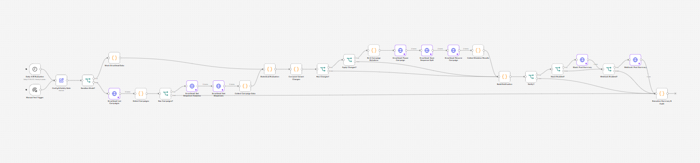

<div align="center">

# n8n-smartlead-campaign-ab-test-winner-auto-promoter

**Outbound optimization workflow that analyzes cold email variant reply rates over a statistical window in Smartlead, automatically evaluating statistical significance, pausing underperforming email variants, and scaling the winning variant.**

A dhRobin Systems Revenue Infrastructure blueprint

     

</div>

---

## Table of Contents

1. [Overview](#1-overview)
2. [Architecture and Data Flow](#2-architecture-and-data-flow)
3. [Repository Contents](#3-repository-contents)
4. [Prerequisites](#4-prerequisites)
5. [5-Minute Sandbox Quick Start](#5-5-minute-sandbox-quick-start)
6. [Step-by-Step Import and Configuration Guide](#6-step-by-step-import-and-configuration-guide)
7. [Environment Variables](#7-environment-variables)
8. [Node-by-Node Configuration Guide](#8-node-by-node-configuration-guide)
9. [Statistical Model](#9-statistical-model)
10. [Safety Matrix](#10-safety-matrix)
11. [Data Protection and Compliance](#11-data-protection-and-compliance)
12. [Operations and Troubleshooting](#12-operations-and-troubleshooting)
13. [Disclaimer and License](#13-disclaimer-and-license)

---

## 1. Overview

Most cold email A/B tests are never closed. A variant that replies at half the rate of its sibling keeps receiving its share of leads for weeks, because someone has to remember to look, decide whether the gap is real, and edit the split. On the other side, tests that are "closed" by eyeballing two percentages on a dashboard often promote noise.

I built this workflow to close tests on evidence. Every day it reads per-variant counters for each step of each active Smartlead campaign and runs a two-proportion z-test of each variant against the step's leader, with the significance level corrected for the number of comparisons. A variant is paused only when it is significantly and materially worse. The winner takes the freed traffic only after it clears minimum sample, minimum events, minimum reply rate, maximum bounce rate and a cooldown.

**Per run, the workflow:**

1. Lists Smartlead campaigns and keeps `ACTIVE` main campaigns, optionally limited by `CAMPAIGN_IDS` or `CAMPAIGN_TAG`.
2. Reads per-step, per-variant counters (`sent_count`, `reply_count`, `positive_reply_count`, `bounce_percentage`) for the last `STATS_WINDOW_DAYS` from `GET /campaigns/{id}/sequence-analytics`.
3. Reads the full sequence (step ids, copy, delays, variant ids) from `GET /campaigns/{id}/sequences`.
4. Evaluates each multi-variant step and decides `promote_winner`, `pause_losers` or `keep_running`, with the reason.
5. Builds a new `MANUAL_PERCENTAGE` split (losers → `LOSER_FLOOR_PERCENT`, inconclusive variants keep their share, the leader takes the rest), in multiples of 10.
6. With `PROMOTE_WINNERS=true` and dry run off: **pauses** the campaign, **saves** the sequence with the new split, and **resumes** the campaign. Smartlead rejects sequence edits while a campaign is `ACTIVE`, and the resume step runs even if the save fails.
7. Posts a summary to Slack and/or a webhook, and emits an audit record.

**Design principles**

| Principle | Implementation |
|---|---|
| Safe by default | With no environment variables set, the workflow makes **zero Smartlead calls and zero campaign changes**. Applying changes needs `SANDBOX_MODE=false`, `DRY_RUN=false` **and** `PROMOTE_WINNERS=true`. |
| Statistics before opinions | Each pause or promotion requires a significant result after Bonferroni correction *and* a minimum relative lift. "Leading" isn't "winning". |
| Guardrails on the winner | Minimum events, minimum reply rate (the conversion threshold), maximum bounce rate, and a per-step cooldown, so a step isn't changed twice in quick succession. |
| Never rewrite copy | The save payload is rebuilt from the live sequence (same step ids, subjects, bodies, delays, variant ids). Only the decided step's split changes. A campaign is blocked instead if any step lacks its copy, if variants can't be matched, or if an untouched step's split would be reset. |
| Never strand a campaign | Resume runs for every paused campaign, also after a failed save. A campaign whose resume fails is named in Slack and in the audit (`changes_failed_campaign_paused`). |
| Secrets out of data | `SMARTLEAD_API_KEY` is used only in HTTP query parameter fields (Smartlead authenticates via the `api_key` query parameter). Webhook URLs and tokens appear only as `{{ $env.* }}` in HTTP URL and header fields. |

---

## 2. Architecture and Data Flow

```mermaid
flowchart LR
    SCH[Daily A/B Evaluation<br/>07:15 UTC] --> CFG
    MAN[Manual Test Trigger] --> CFG[Config & Safety Gate]
    CFG --> SB{Sandbox Mode?}
    SB -- yes --> MOCK[Mock Smartlead Data<br/>sample-payloads/campaign-stats.json]
    SB -- no --> LC[Smartlead: List Campaigns] --> SEL[Select Campaigns<br/>ACTIVE · ids · tag · cap]
    SEL --> HC{Has Campaigns?}
    HC -- no --> AUD
    HC -- yes --> SA[Smartlead: Get Sequence Analytics<br/>per campaign · window] --> GS[Smartlead: Get Sequences<br/>per campaign] --> COL[Collect Campaign Data]
    MOCK --> EV
    COL --> EV[Statistical Evaluation<br/>sample gate · z-test vs leader · Bonferroni · guardrails]
    EV --> CMP[Compose Variant Changes<br/>new splits · full-sequence payload · pre-flight]
    CMP --> CH{Has Changes?}
    CH -- no --> NOTE
    CH -- yes --> AP{Apply Changes?<br/>!sandbox · !dry run · PROMOTE_WINNERS}
    AP -- no --> NOTE
    AP -- yes --> EM[Emit Campaign Mutations] --> PA[Smartlead: Pause Campaign] --> SV[Smartlead: Save Sequence Split] --> RS[Smartlead: Resume Campaign<br/>always runs] --> CM[Collect Mutation Results]
    CM --> NOTE[Build Notification]
    NOTE --> NT{Notify?}
    NT -- no --> AUD
    NT -- yes --> SE{Slack Enabled?}
    SE -- yes --> SL[Slack: Post Summary] --> WE
    SE -- no --> WE{Webhook Enabled?}
    WE -- yes --> WH[Webhook: Post Summary] --> AUD
    WE -- no --> AUD[Execution Summary & Audit]
```





### Stage contracts

| Stage | Output shape |
|---|---|
| Mock Smartlead Data / Collect Campaign Data | `{ source, window{ start, end }, campaigns: [{ campaignId, name, status, analytics, sequences, readErrors[] }], skipped[] }` |
| Statistical Evaluation | `{ counts{ campaigns, steps, tested, promote_winner, pause_losers, keep_running }, campaigns: [{ steps: [{ stepId, seqNumber, variants[{ variantId, label, sent, events, rate, bouncePct }], decision, reason, leader, winner, losers[], inconclusive[], comparisons[] }] }] }` |
| Compose Variant Changes | Same, plus `changes[{ campaignId, seqNumber, decision, before{}, after{}, comparisons[] }]`, `mutations[{ campaignId, payload{ sequences[] }, notes[] }]`, `blocked[]` |
| Collect Mutation Results | `{ results[{ campaignId, paused, saved, resumed, error }], applied, failed, notResumed[] }` |
| Build Notification | `{ worthNotifying, slackBody, webhookBody }` |
| Execution Summary & Audit | Outcome, safety flags, settings, per-step decisions with counts, changes, blocked campaigns, mutation results, notification results |

---

## 3. Repository Contents

```
n8n-smartlead-campaign-ab-test-winner-auto-promoter/
├── README.md                        Technical documentation (this file)
├── workflow.json                    Importable n8n workflow with sticky notes and pinned synthetic payloads
├── DISCLAIMER.md                    Liability limitation and usage terms
├── LICENSE                          MIT License
└── sample-payloads/
    └── campaign-stats.json          Synthetic campaign list, sequence analytics and sequences (also embedded in the sandbox node)
```

Every campaign, ID, subject line, body and figure in these files is fictitious.

---

## 4. Prerequisites

| Requirement | Detail |
|---|---|
| n8n | Self-hosted **1.60 or later** (Schedule Trigger 1.2, Set 3.4, IF 2, Code 2, HTTP Request 4.2, `$('Node').isExecuted`, `v1` execution order). |
| Env access | `N8N_BLOCK_ENV_ACCESS_IN_NODE=false`, so `{{ $env.* }}` expressions resolve. |
| Smartlead | An API key from *Settings → API* on a plan with API access. The key has full account access, so treat it as a production secret. |
| Smartlead A/B setup | Campaign steps with two or more variants. The workflow writes `MANUAL_PERCENTAGE` splits on the steps it changes. |
| Slack (optional) | An incoming webhook URL. |
| Webhook (optional) | Any HTTPS endpoint that accepts JSON, with an optional bearer token. |

> **The API key travels as a query parameter.** Smartlead authenticates with `?api_key=…`. n8n doesn't store request URLs in successful execution data, but an HTTP error message can include the request URL. Restrict access to executions, and rotate the key if an execution export leaves your team.

> **n8n Cloud:** you can't define your own environment variables there. Replace each `$env.X` with `$vars.X` (on plans with Variables). The workflow logic is unchanged.

---

## 5. 5-Minute Sandbox Quick Start

1. **Run n8n locally:**
   ```bash
   docker run -it --rm -p 5678:5678 \
     -e N8N_BLOCK_ENV_ACCESS_IN_NODE=false \
     -e GENERIC_TIMEZONE=UTC \
     -v n8n_data:/home/node/.n8n \
     docker.n8n.io/n8nio/n8n
   ```
2. **Import** `workflow.json` (*Workflows → Import from File*).
3. Click **Test workflow** on *Manual Test Trigger*.
4. Open **Statistical Evaluation**, **Compose Variant Changes** and **Execution Summary & Audit**.

**Expected sandbox result** (defaults: reply metric, 200 sends per variant, α = 0.01, lift ≥ 20%, leader ≥ 10 replies and ≥ 1% reply rate, bounce ≤ 5%):

| Campaign · step | Replies / sends | Decision | Why |
|---|---|---|---|
| `12345` · 1 | A 18/1200 (1.50%) · B 47/1180 (3.98%) | 🏆 `promote_winner` | B > A, p ≈ 1.0e-4. Split A 50 → **0**, B 50 → **100** |
| `12345` · 2 | A 9/640 · B 12/655 | `keep_running` | No significant difference (p ≈ 0.27). Its 50/50 split is preserved in the payload. |
| `12346` · 1 | A 27/900 · B 8/880 · C 29/870 | ✂️ `pause_losers` | C > B (p ≈ 2.1e-4 < 0.01/2). C vs A inconclusive. Split A 33 → 30, B → **0**, C → **70** |
| `12347` · 1 | A 2/150 · B 7/140 | `keep_running` | Insufficient sample (< 200 per variant) |
| `12348` · 1 | A 12/1000 · B 41/1010 | `keep_running` | B is significantly better but bounces 7.4% (> 5%) |
| `12350` · 1 | A 1/2000 · B 14/2000 | `keep_running` | B is significantly better but replies at only 0.70% (< 1%) |
| `12349` | — | skipped | Campaign is `PAUSED` |

The audit outcome is `changes_found_sandbox`. *Compose Variant Changes* holds the exact Smartlead save payloads (`mutations[].payload`) that a live run would send.

---

## 6. Step-by-Step Import and Configuration Guide

Each step changes one thing and has an exit check.

| Step | Configuration | Exit check |
|---|---|---|
| **1. Import and sandbox** | Defaults | The table in [§5](#5-5-minute-sandbox-quick-start) is reproduced. |
| **2. Pinned live path** | `SANDBOX_MODE=false`, `SMARTLEAD_API_KEY=synthetic`, `DRY_RUN=false`, `PROMOTE_WINNERS=true`, `NOTIFY_CHANNELS=slack,webhook`, any `SLACK_WEBHOOK_URL` / `ALERT_WEBHOOK_URL`. Run **Test workflow** | Every node runs on pinned synthetic responses: two campaigns paused, saved and resumed, `outcome: changes_applied`. No request reaches Smartlead or Slack. |
| **3. Live reads, dry run** | Unpin *List Campaigns*, *Get Sequence Analytics*, *Get Sequences* (*right-click → Unpin*). Real `SMARTLEAD_API_KEY`, `DRY_RUN=true`, `CAMPAIGN_IDS=<one test campaign>` | *Statistical Evaluation* shows the same per-variant sends and replies as the campaign's Analytics tab for the window. |
| **4. Review payloads** | Same | For each `mutations[]` entry, compare `payload.sequences` with the campaign in Smartlead: every step id, subject, body, delay and variant id present and unchanged. Resolve any `blocked` reason. |
| **5. Slack** | Unpin *Slack: Post Summary*, `NOTIFY_CHANNELS=slack`, a test-channel `SLACK_WEBHOOK_URL` | One summary per run, labelled **DRY RUN**. |
| **6. First live change** | Unpin the three mutation nodes. `DRY_RUN=false`, `PROMOTE_WINNERS=true`, still a single test campaign | In Smartlead, the step shows the new split, the copy is unchanged, and the campaign is `ACTIVE` again. |
| **7. Schedule** | Widen `CAMPAIGN_IDS` or switch to `CAMPAIGN_TAG=ab-auto`, then activate the workflow | Next day: changes in Slack as **LIVE**. Changed steps show `cooldown` until `COOLDOWN_DAYS` pass. |

> **Tag-based opt-in is the cleanest rollout.** Tag the campaigns you want managed (e.g. `ab-auto`) in Smartlead and set `CAMPAIGN_TAG=ab-auto`. Campaigns without the tag are never touched.

---

## 7. Environment Variables

All variables are optional. Unset values resolve to the safest behaviour.

### 7.1 Safety gate

| Variable | Default | Effect |
|---|---|---|
| `SANDBOX_MODE` | `true` | Synthetic data. No Smartlead or notification calls. |
| `DRY_RUN` | `true` | Decisions and payloads are built. No campaign is changed. |
| `PROMOTE_WINNERS` | `false` | Explicit opt-in for pause → save → resume. Effective only with `SANDBOX_MODE=false` and `DRY_RUN=false`. |
| `ALLOW_EQUAL_SPLIT_ASSUMPTION` | `false` | Allow saving a campaign when an *untouched* multi-variant step's current split isn't returned by the API. That step is then saved as `MANUAL_EQUAL`. |

### 7.2 Test thresholds

| Variable | Default | Effect |
|---|---|---|
| `TEST_METRIC` | `reply` | `reply` (`reply_count`) or `positive_reply` (`positive_reply_count`, needs lead categorisation in Smartlead). |
| `MIN_SAMPLE_SIZE` | `200` | Minimum sends per variant in the window, for **every** variant of the step. |
| `SIGNIFICANCE_ALPHA` | `0.01` | Family-wise significance level. Each of the k − 1 comparisons uses α / (k − 1). |
| `MIN_RELATIVE_LIFT` | `0.2` | Leader must beat a loser by at least this relative margin (0.2 = 20%). |
| `MIN_WINNER_REPLY_RATE_PCT` | `1` | Conversion threshold: no change unless the leader's rate reaches this percentage. |
| `MIN_WINNER_EVENTS` | `10` | Minimum replies (or positive replies) on the leader. |
| `MAX_BOUNCE_RATE_PCT` | `5` | No promotion of a leader whose bounce rate is above this. |
| `LOSER_FLOOR_PERCENT` | `0` | Share left on losers: `0` (paused), `10` or `20` (keep exploring). |
| `COOLDOWN_DAYS` | `7` | Days before a changed step can be changed again (production runs). |
| `STATS_WINDOW_DAYS` | `30` (1–180) | Reporting window passed as `start_date` / `end_date`. |
| `STATS_TIME_ZONE` | `UTC` | `time_zone` for the analytics window. |

### 7.3 Campaign selection

| Variable | Default | Effect |
|---|---|---|
| `CAMPAIGN_IDS` | — | Comma-separated campaign IDs to manage. Empty = all active campaigns. |
| `CAMPAIGN_TAG` | — | Only campaigns carrying this Smartlead tag. |
| `MAX_CAMPAIGNS_PER_RUN` | `25` (1–100) | Cap per run. |

### 7.4 Endpoints and notifications

| Variable | Default | Effect |
|---|---|---|
| `SMARTLEAD_API_KEY` 🔒 | — | Smartlead API key (query parameter `api_key`). |
| `SMARTLEAD_API_BASE_URL` | `https://server.smartlead.ai/api/v1` | API base URL. |
| `NOTIFY_CHANNELS` | `slack` | `slack`, `webhook` or both. A channel is active only when its URL is also set. |
| `SLACK_WEBHOOK_URL` 🔒 | — | Slack incoming webhook. |
| `ALERT_WEBHOOK_URL` 🔒 | — | Generic JSON webhook. |
| `ALERT_WEBHOOK_TOKEN` 🔒 | — | Sent as `Authorization: Bearer …` to the webhook. |
| `NOTIFY_ON_NO_CHANGE` | `false` | Also post when nothing changed or was blocked. |

🔒 = secret. Inject from a secret manager, never commit.

### 7.5 Sample `.env` (staging)

```bash
# n8n runtime
N8N_BLOCK_ENV_ACCESS_IN_NODE=false

# Safety gate: live reads, recommendations only
SANDBOX_MODE=false
DRY_RUN=true
PROMOTE_WINNERS=false

# Scope
CAMPAIGN_TAG=ab-auto
MAX_CAMPAIGNS_PER_RUN=10

# Thresholds
TEST_METRIC=reply
MIN_SAMPLE_SIZE=200
SIGNIFICANCE_ALPHA=0.01
MIN_RELATIVE_LIFT=0.2
MIN_WINNER_REPLY_RATE_PCT=1
STATS_WINDOW_DAYS=30

# Secrets (inject from your secret manager; never commit)
SMARTLEAD_API_KEY=
SLACK_WEBHOOK_URL=
```

---

## 8. Node-by-Node Configuration Guide

### 8.1 Triggers and Config & Safety Gate

- **Daily A/B Evaluation** runs at 07:15 in the workflow timezone (UTC). You can run it hourly, but every extra look at the data raises the false-positive rate (see [§9.3](#93-what-this-test-does-not-protect-against)).
- **Config & Safety Gate** clamps every number, validates enums, computes the window (`windowStart`, `windowEnd`) once per run, and sets `promoteWinners` only when all three safety conditions hold.

### 8.2 Smartlead reads

| Node | Call | Notes |
|---|---|---|
| Smartlead: List Campaigns | `GET /campaigns/?api_key=…&include_tags=true` | Smartlead returns a top-level array, which n8n splits into one item per campaign. *Select Campaigns* accepts both forms. |
| Select Campaigns | — | Keeps `ACTIVE` campaigns without `parent_campaign_id`, then applies `CAMPAIGN_IDS`, `CAMPAIGN_TAG` and the cap. Skipped campaigns (first 50) are reported with a reason. |
| Smartlead: Get Sequence Analytics | `GET /campaigns/{id}/sequence-analytics?start_date&end_date&time_zone` | One entry per step, with `variants[]` carrying `id`, `variant_label` and `stats` (`sent_count`, `reply_count`, `positive_reply_count`, `bounce_percentage`, …). |
| Smartlead: Get Sequences | `GET /campaigns/{id}/sequences` | Step `id`, `seq_number`, `subject`, `email_body`, `seq_delay_details`, `sequence_variants[]` (`id`, `variant_name`, `subject`, `email_body`). |
| Collect Campaign Data | — | Index-aligned join with a count guard. A failed read becomes `readErrors` on that campaign. |

The read nodes process one campaign at a time with a 400 ms gap, so a 25-campaign run makes about 51 read calls.

### 8.3 Statistical Evaluation

Implements [§9](#9-statistical-model). Each multi-variant step gets a `decision`, a human-readable `reason` and the full list of `comparisons` (leader rate, challenger rate, z, p-value, adjusted α, relative lift, significant).

### 8.4 Compose Variant Changes

For each campaign with a decided step:

1. Rebuilds **every** step from *Get Sequences*: `id`, `seq_number`, `subject`, `email_body`, `seq_delay_details.delay_in_days`.
2. On the decided step, sets `variant_distribution_type: "MANUAL_PERCENTAGE"` and `seq_variants[]` with each variant's `id`, copy, `variant_label` and new `variant_distribution_percentage`:
   - losers → `LOSER_FLOOR_PERCENT`
   - inconclusive variants → their current share, rounded down to a multiple of 10 (minimum 10)
   - leader → the remainder
3. Untouched multi-variant steps keep their split when the API returns it (`variant_distribution_percentage`, `distribution_percentage`, `distribution` or `variant_distribution`). Otherwise the campaign is **blocked**, unless `ALLOW_EQUAL_SPLIT_ASSUMPTION=true`.

**Pre-flight blocks:** sequences unavailable, a step without `email_body`, analytics variants that don't match the sequence variants (by id, then label), or no valid multiple-of-10 split. When the prior split of the *decided* step isn't returned by the API, the change is still made, and Slack marks it *prior split assumed equal*.

> **Why multiples of 10:** Smartlead's manual percentage distribution only honours shares in multiples of 10. A share of 0 takes the variant out of rotation without deleting it or its statistics.

### 8.5 Mutation chain

| Node | Call |
|---|---|
| Smartlead: Pause Campaign | `POST /campaigns/{id}/status` `{ "status": "PAUSED" }` |
| Smartlead: Save Sequence Split | `POST /campaigns/{id}/sequences` with the composed `{ sequences: [...] }` |
| Smartlead: Resume Campaign | `POST /campaigns/{id}/status` `{ "status": "START" }`. Runs for every campaign, including after a failed save, with 5 retries. |
| Collect Mutation Results | Index-aligned results. Records the change time per step for the cooldown (production runs only). |

Only campaigns that were `ACTIVE` are selected, so resuming restores their original state. `STOPPED` is never used: it's permanent in Smartlead.

### 8.6 Notifications and audit

**Build Notification** creates one Slack message (mode banner, counts, one section per change with the split before → after and each comparison's p-value, blocked campaigns, campaigns that may still be paused, and steps still running) and one webhook document (`event: "smartlead.ab_test.evaluated"`). It posts only when something changed, was blocked or failed, unless `NOTIFY_ON_NO_CHANGE=true`.

**Execution Summary & Audit** outcomes: `no_tests_evaluated`, `no_changes_needed`, `changes_blocked`, `changes_found_sandbox`, `changes_recommended_dry_run`, `changes_applied`, `changes_partially_applied`, `changes_failed_campaign_paused`.

---

## 9. Statistical Model

### 9.1 Per step

1. **Sample gate:** every variant needs `sent_count ≥ MIN_SAMPLE_SIZE` in the window. Otherwise the decision is `keep_running` (`insufficient_sample`).
2. **Leader:** the variant with the highest rate `events / sent`, where events are replies or positive replies.
3. **Comparison:** for each challenger, a pooled two-proportion z-test of leader vs. challenger:

   ```
   p̂ = (x₁ + x₂) / (n₁ + n₂)
   z  = (x₁/n₁ − x₂/n₂) / √( p̂(1 − p̂)(1/n₁ + 1/n₂) )
   p  = 1 − Φ(z)                     (one-sided: leader better)
   ```

4. **Multiple comparisons:** with k variants there are k − 1 comparisons, each tested at α / (k − 1) (Bonferroni).
5. **Materiality:** a challenger is a **loser** only if p < α / (k − 1) **and** `(rate_leader − rate_challenger) / rate_challenger ≥ MIN_RELATIVE_LIFT`.
6. **Decision:**
   - all challengers are losers → `promote_winner` (the leader takes all traffic not left on losers by `LOSER_FLOOR_PERCENT`)
   - some losers → `pause_losers` (losers drop, inconclusive variants keep their share, the leader takes the rest)
   - none → `keep_running`
7. **Guardrails** (any one keeps the step running): leader events < `MIN_WINNER_EVENTS`, leader rate < `MIN_WINNER_REPLY_RATE_PCT`, leader bounce > `MAX_BOUNCE_RATE_PCT`, or a change within `COOLDOWN_DAYS`.

### 9.2 Sample size guidance

To detect a lift from 2% to 3% reply rate (50% relative) at α = 0.01 one-sided with 80% power, you need roughly 4,900 sends per variant. `MIN_SAMPLE_SIZE=200` is a floor that stops obviously premature decisions, not a power calculation. Set it to the volume your typical effect sizes need.

### 9.3 What this test does not protect against

- **Repeated looks.** Re-testing the same accumulating data every day inflates the false-positive rate above α. Keep α small (0.01 or lower), keep the window fixed, and keep the cooldown.
- **Reply lag.** Replies arrive days after sends, so recent sends depress all variants' rates equally. Comparisons stay fair, but absolute rates read low.
- **Confounding.** Variants that ran at different times, to different lead lists, or through different mailboxes are not a randomised comparison. Smartlead's split assigns variants per lead, which is what makes this test valid; don't edit variants mid-test.
- **Downstream outcomes.** Reply rate isn't revenue. Use `TEST_METRIC=positive_reply` when lead categorisation is reliable, and review promoted winners against meetings booked.

---

## 10. Safety Matrix

| `SANDBOX_MODE` | `DRY_RUN` | `PROMOTE_WINNERS` | Smartlead reads | Pause / save / resume | Slack / webhook |
|:---:|:---:|:---:|:---:|:---:|:---:|
| `true` *(default)* | any | any | No (mock) | No | No |
| `false` | `true` *(default)* | any | Yes | No | Yes, if configured (labelled DRY RUN) |
| `false` | `false` | `false` *(default)* | Yes | No | Yes, if configured (labelled DRY RUN) |
| `false` | `false` | `true` | Yes | **Yes** | Yes, if configured (labelled LIVE) |

**Pinned data:** pins apply only to manual executions. Scheduled production runs always call Smartlead according to this matrix. The read pins hold 5 campaigns and the mutation pins hold 2, matching the synthetic data. With other data, the count guards stop the run instead of misattributing responses. Unpin every Smartlead node before a manual live test.

---

## 11. Data Protection and Compliance

| Data element | Read | Written | In Slack / webhook / audit |
|---|:---:|:---:|:---:|
| Campaign names, statuses, tags | Smartlead | — | Names and IDs |
| Variant counters (sent, replies, bounces) | Smartlead | — | Yes |
| Step and variant copy | Smartlead | Same copy, written back unchanged | No |
| Lead data | **Not read** | — | No |

**My recommendations before going live**

- **Opt in per campaign.** Use `CAMPAIGN_TAG` so only campaigns the team has agreed to automate are changed.
- **Protect the key.** The Smartlead key grants full account access. Store it in a secret manager, restrict who can open n8n executions, and rotate it if an export leaves your team.
- **Keep a human in the loop at first.** Run in dry run for two weeks, compare the recommendations with your team's judgement, then enable `PROMOTE_WINNERS`.
- **Watch deliverability.** A winner concentrates volume on one copy. Keep `MAX_BOUNCE_RATE_PCT` strict, and watch inbox placement after promotions.
- **Stay compliant.** Automatic optimisation doesn't change your obligations under CAN-SPAM, GDPR/PECR or similar laws. Every variant must carry a valid unsubscribe and accurate sender identity.
- **Version control hygiene:** before committing an edited workflow, run:

```bash
grep -nE '(api_key=[A-Za-z0-9_-]{16,}|hooks\.slack\.com/services/[A-Z0-9]+/|Bearer [A-Za-z0-9._-]{20,})' workflow.json && echo "Possible secret found" || echo "Clean"
```

---

## 12. Operations and Troubleshooting

### 12.1 Call volume per run

| Calls | Count |
|---|---|
| List campaigns | 1 |
| Sequence analytics + sequences | 2 per selected campaign |
| Pause + save + resume | 3 per changed campaign |
| Slack / webhook | ≤ 1 each |

### 12.2 Troubleshooting

| Symptom | Likely cause | Fix |
|---|---|---|
| `Smartlead campaign list failed` / `401 Invalid API Key` | Wrong or rotated key | Check `SMARTLEAD_API_KEY`. |
| `400` on sequence analytics | Malformed window | `STATS_WINDOW_DAYS` must be 1–180. Check `STATS_TIME_ZONE` is a valid IANA zone. |
| Every step `insufficient_sample` | Low volume or a short window | Lengthen `STATS_WINDOW_DAYS`, or lower `MIN_SAMPLE_SIZE` knowingly. |
| Campaign `blocked: … current split is not exposed by the API` | Smartlead didn't return the split of an untouched multi-variant step | Set the split manually in Smartlead and re-test, or accept `ALLOW_EQUAL_SPLIT_ASSUMPTION=true` if equal splits are what you use. |
| Campaign `blocked: analytics variants do not match` | A variant was added or deleted during the window | Wait until the window only covers the current variants. |
| Save `400` / `422` | Payload rejected (Smartlead validation or a field-name change) | Compare `mutations[].payload` with Smartlead's current *Update Campaign Sequences* reference. The campaign was resumed. |
| Slack shows **campaigns may still be PAUSED** | Resume failed after retries | Resume the named campaign in Smartlead now. The audit lists it under `mutations[].resumed: false`. |
| Same step changed again too soon | Manual executions | Cooldown state is written only by production executions. |
| `429` | Rate limit | Lower `MAX_CAMPAIGNS_PER_RUN`, or raise the batch interval on the read nodes. |

---

## 13. Disclaimer and License

### ⚠️ Disclaimer & Liability Limitation

**Use at your own risk.** The code, workflows, and scripts in this repository (`n8n-smartlead-campaign-ab-test-winner-auto-promoter`) are provided for educational and architectural demonstration purposes.

- **No Liability:** The author and dhRobin Systems accept no responsibility or liability for any direct, indirect, incidental, or consequential damages that result from using, misusing, or deploying these scripts.
- **No Warranty:** All software, n8n JSON blueprints, JavaScript modules and prompts are provided "AS IS", without warranty of any kind, express or implied. This includes, but is not limited to, warranties of merchantability, fitness for a particular purpose, and non-infringement.
- **Production Testing Required:** Always test thoroughly in an isolated staging environment, such as a dedicated Smartlead test campaign, with `SANDBOX_MODE=true` and `DRY_RUN=true` enabled, before you connect live Smartlead credentials or enable `PROMOTE_WINNERS`. Treat every automated decision as a recommendation that a person must be able to review and reverse.
- **Third-Party APIs & Compliance:** You alone are responsible for complying with the terms of service, rate limits, data privacy regulations (GDPR/CCPA), anti-spam laws (CAN-SPAM, PECR and equivalents), and security policies of Smartlead, Slack and any connected services. That includes securing the Smartlead API key and webhook URLs, keeping valid unsubscribe and sender details in every variant, and reviewing every automatically changed campaign.

The full disclaimer is also available in [DISCLAIMER.md](DISCLAIMER.md).

### License

Released under the MIT License. Copyright (c) 2026 DH Robin (dhRobin Systems). See [LICENSE](LICENSE).

---

Full text: DISCLAIMER.md · Licensed under the MIT License. License: MIT © 2026 dhRobin Systems · Provided as-is, see the disclaimer.
